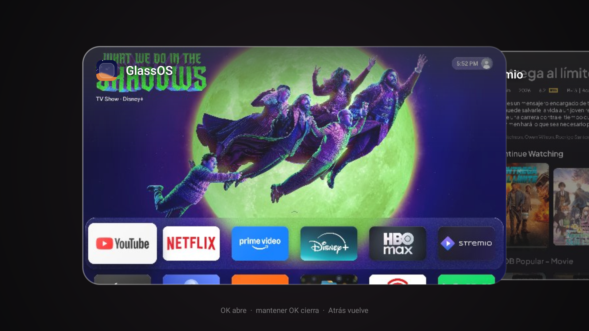
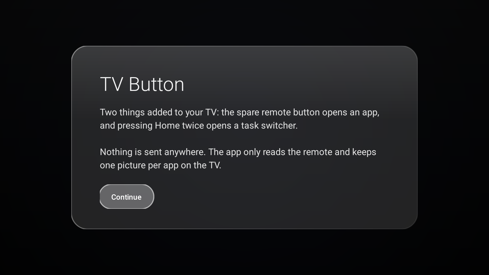

# TV Button — for GlassOS

A tiny companion app for [GlassOS](https://github.com/AbhishekKaisar/glassos-tv) on Android TV and
Google TV. It adds the two things a clean launcher leaves behind: it puts the remote's spare button to
work, and it brings back a **task switcher** — Home twice, a stack of cards showing each app's own last
screen, OK to go back to it, hold OK to close it.

Written in the same visual language as GlassOS: glass cards, the app's accent colour, the blurred screen
behind. 18 KB, no dependencies, nothing sent anywhere.

| Switcher | Setup |
|---|---|
|  |  |

## What it does

| Gesture | Result |
|---|---|
| **Home twice** (within 600 ms) | The app switcher: the app you are in, in front, with the apps you used before stacked behind its left edge |
| **Left / Right** | Back through older apps, forward again to the one you were in |
| **OK** | Opens the focused app |
| **Hold OK** | Closes it — `killBackgroundProcesses`, plus it leaves the stack |
| **Back** | Leaves the switcher |
| **The remote's spare button** (the one that used to open Xiaomi TV+ / Mi TV+) | Opens the app you set in `KeyBridge.TARGET` (Stremio by default) |
| **The “!” circle**, bottom right of the switcher | These instructions again |

## Requirements

- Android TV or Google TV on **Android 11+** (the cards come from `AccessibilityService.takeScreenshot()`,
  API 30). The button half and the stack itself work on 8.0+ (`minSdk 26`), only the pictures need 11+.
- The TV must be **debloated enough to have no switcher of its own** — this exists because disabling the
  stock launcher (`com.google.android.apps.tv.launcherx`) also removes `KEYCODE_APP_SWITCH` handling.
  If your stock launcher is still enabled, pressing its own Recents button works and you may not need this.
- A way to run two ADB commands once (a computer, or any of the setup tools out there).

## Install

Download the APK from the [Releases](../../releases) page and sideload it, or:

    adb connect <tv-ip>:5555
    adb install TVButton.apk
    adb shell am start -n tv.button/.SetupActivity

Then grant the two permissions, once — they survive reboots, and must be re-granted after reinstalling:

    adb shell appops set tv.button GET_USAGE_STATS allow
    adb shell settings put secure enabled_accessibility_services tv.button/tv.button.KeyBridge
    adb shell settings put secure accessibility_enabled 1

Turn USB debugging off afterwards (`settings put global adb_enabled 0`): port 5555 is plaintext.

## Build from source

Needs a **JDK 17** and the Android SDK with platform 34. Any OS:

```sh
git clone https://github.com/Ancordss/tv-button
cd tv-button
echo "sdk.dir=$HOME/Library/Android/sdk" > local.properties   # Windows: C:\\Users\\you\\AppData\\Local\\Android\\Sdk

# macOS (Homebrew JDK 17)
JAVA_HOME=/opt/homebrew/opt/openjdk@17 ./gradlew assembleRelease
# Linux
JAVA_HOME=/usr/lib/jvm/java-17-openjdk-amd64 ./gradlew assembleRelease
# Windows (PowerShell)
$env:JAVA_HOME="C:\Program Files\Eclipse Adoptium\jdk-17"; .\gradlew.bat assembleRelease
```

The APK lands in `app/build/outputs/apk/release/app-release.apk`. `assembleRelease` is R8-minified and
resource-shrunk (18 KB) and signed with your local debug key, so `adb install -r` upgrades in place over
a debug build. Use `assembleDebug` only if you need `run-as` to look inside the app's data.

No Android Studio is required: the Gradle wrapper fetches Gradle 8.9, and AGP downloads platform 34 on
first build if it is missing (licences must already be accepted: `sdkmanager --licenses`).

## Configure

Everything is one constant, then rebuild and reinstall:

| What | Where |
|---|---|
| App opened by the spare button | `TARGET` + `TARGET_ACTIVITY` in `app/src/main/java/tv/button/KeyBridge.java` |
| Double-Home window | `DOUBLE_PRESS_MS` in `KeyBridge.java` (600 ms) |
| Card size, how far each card of the pile sticks out, radius | `CARD_W`, `CARD_H`, `STEP`, `RADIUS` in `SwitcherView.java` |
| How long a card keeps its picture | `WINDOW_MS` (24 h) and `MAX_CARDS` (12) in `RecentsActivity.java` |
| The accent behind the setup panel | `ACCENT` in `SetupActivity.java` |
| Text | `app/src/main/res/values/strings.xml` (English) and `values-es/` (Spanish) |

Text follows the TV's language: the app ships English and Spanish, and the system locale picks. Send a
`values-<lang>/strings.xml` to add another.

## How it works

- **One accessibility service, one key filter.** A generic remote button (`KEYCODE_BUTTON_5`, 192, from
  `/vendor/usr/keylayout/Vendor_2717_Product_32b9.kl` on Xiaomi remotes) is delivered only to the focused
  window, so a key filter is the only way to see it while another app is in front. Everything except that
  button and Home is passed straight through.
- **Pictures, not icons.** On every window change the service takes a screenshot 2.5 s later (throttled to
  one per 3 s, refreshed at most every 30 s per app) and keeps a 640 × 360 JPEG (q85, ~68 KB) in the app's
  own cache. That is why a card shows where you left the app.
- **Blank frames are dropped.** Netflix, Disney+ and YouTube hand out `FLAG_SECURE` black frames. A frame
  whose luma spread is under 0.06, or whose mean luma is under 0.02, is thrown away, and the card falls
  back to the app icon on its own dominant colour (the mean of the opaque, saturated pixels of its icon).
- **The stack is one View.** `SwitcherView` paints the pile from the oldest card to the newest and the
  focused one last, so it covers the cards behind it. The focused card sits at 56% of the screen width with
  every older card 92 dp further left, each dimmer and slightly smaller by depth; moving animates that
  offset on a 240 ms decelerating curve. Only the front card is named — in a pile, labels collide.
- **Nothing accumulates.** `Thumbnails.prune()` runs whenever the switcher opens: it keeps only the apps
  being shown, drops anything older than 7 days, and drops pre-JPEG leftovers. Closing an app deletes its
  picture. Bitmaps are recycled when the screen goes away, and the backdrop is kept at half resolution.

## Known limits

- **Closing is best-effort.** `killBackgroundProcesses` does not stop an app with a foreground service
  (YouTube's process comes straight back); the card also leaves the stack, which is what the user sees.
  A real `force-stop` needs a signature permission no sideloaded app has.
- **Pictures are the past, not live.** A card shows the last screen captured, not what the app draws now.
- **Key repeat.** A bound accessibility key filter is the documented way to lose key-repeat on some Mi
  remotes when a button is held. This filter only takes `BUTTON_5` and Home, and other keys fell through
  in testing — but if holding a button stops repeating, uninstall and it goes back to how it was.
- **DRM apps never get a picture**, by design of `FLAG_SECURE`.

## Using it with GlassOS

TV Button is a plain app: install it next to GlassOS, keep GlassOS as the home screen, and the two
permissions above are all it needs. Nothing in GlassOS has to change.

If you maintain GlassOS and want to point people here, one line in your README under an “Extras” or
“Companion apps” heading is enough — the switcher exists precisely because a third-party home screen
cannot answer `KEYCODE_APP_SWITCH`.

## Credits

- Visual language, glass recipe and the icon/dominant-colour approach: [GlassOS](https://github.com/AbhishekKaisar/glassos-tv)
  (`GlassPainter`, `AppRepo`, `Tone`) — same author-facing principles, its own code.
- Debloat context (disabling the stock launcher removes the system switcher): [CleanYourTV](https://github.com/Gathin23/cleanyourtv).
- tvOS for the stack.

## License

GNU GPL v3. See [LICENSE](LICENSE).
